# BÁO CÁO BÀI TẬP / ĐỒ ÁN

## THÔNG TIN SINH VIÊN

- **Họ và tên:** Nguyễn Hoàng Linh
- **Mã số sinh viên:** 24810320338
- **Lớp:** D19QTANM1
- **Tên môn học:** Lập trình C# / Windows Forms
- **Tên bài tập:** TEST 02 - Lập trình Windows Forms Thực hành Nâng cao

---

## KẾT QUẢ THỰC HÀNH CHI TIẾT

### BÀI 1: QUẢN LÝ ĐẶT PHÒNG KHÁCH SẠN
| Giao diện chính | Bắt lỗi Validation | Thao tác Xóa (MessageBox) |
| :---: | :---: | :---: |
| 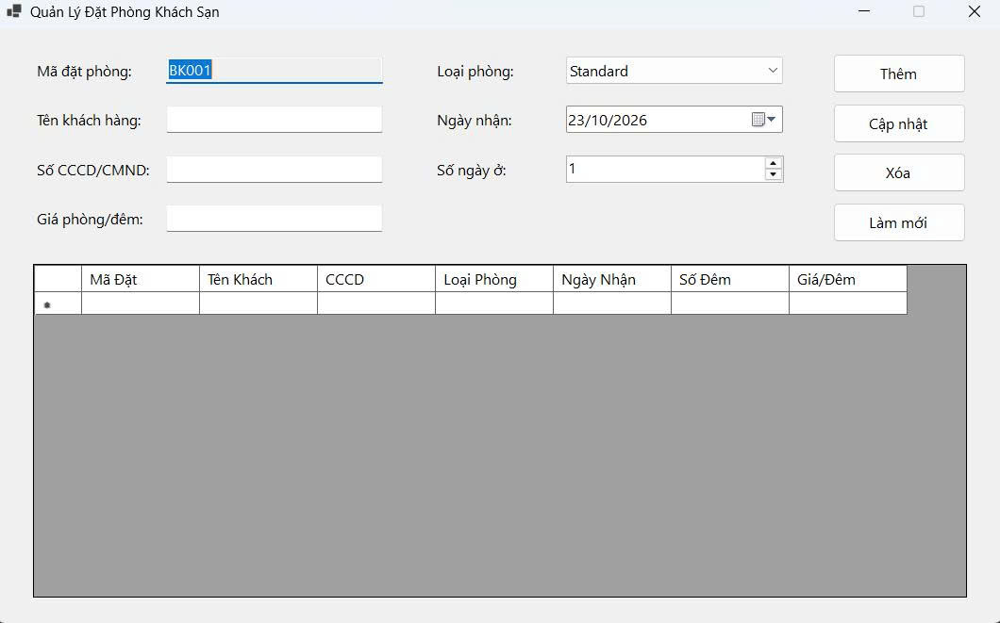 | 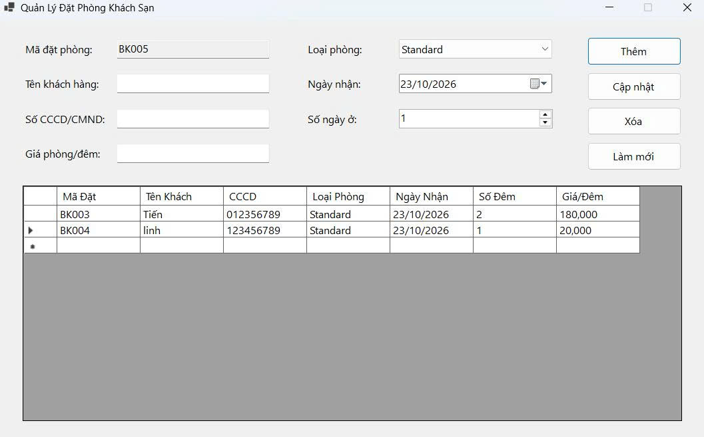 | 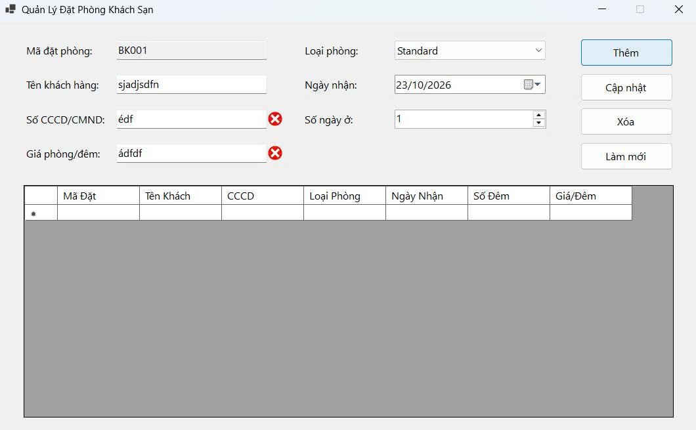 |

---

### BÀI 2: QUẢN LÝ HỒ SƠ NHÂN SỰ & THÔNG TIN LƯƠNG
| Giao diện & Avatar | Hộp thoại Đọc / Ghi CSV | Danh sách nạp từ CSV |
| :---: | :---: | :---: |
| 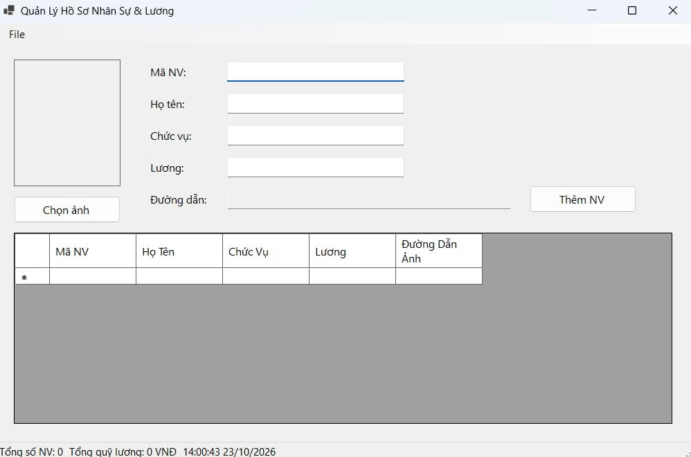 |  | 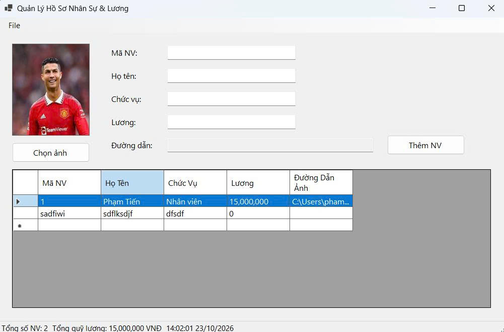 |

---

### BÀI 3: HỆ THỐNG MDI QUẢN LÝ TRƯỜNG HỌC & ĐÀO TẠO
| Khung MDI & Form con | Xếp tầng (Cascade / Tile) | Ngăn chặn Duplicate Form |
| :---: | :---: | :---: |
| 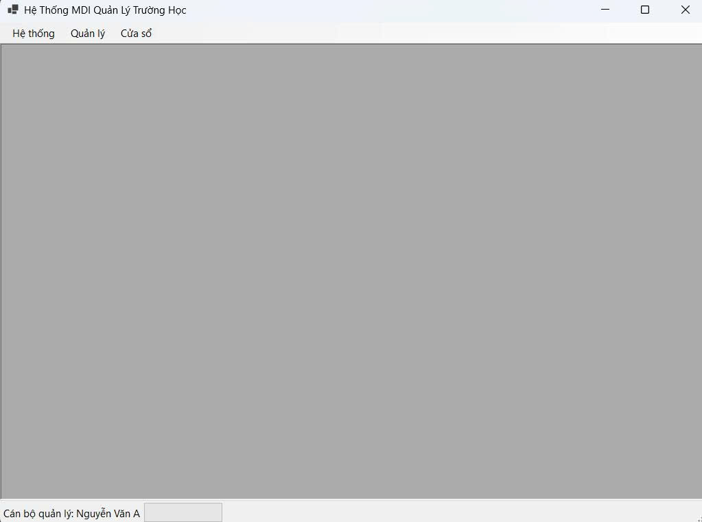 | 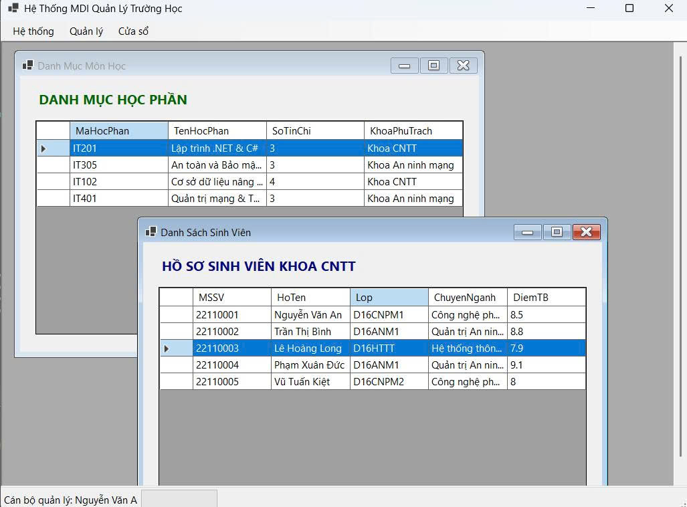 | 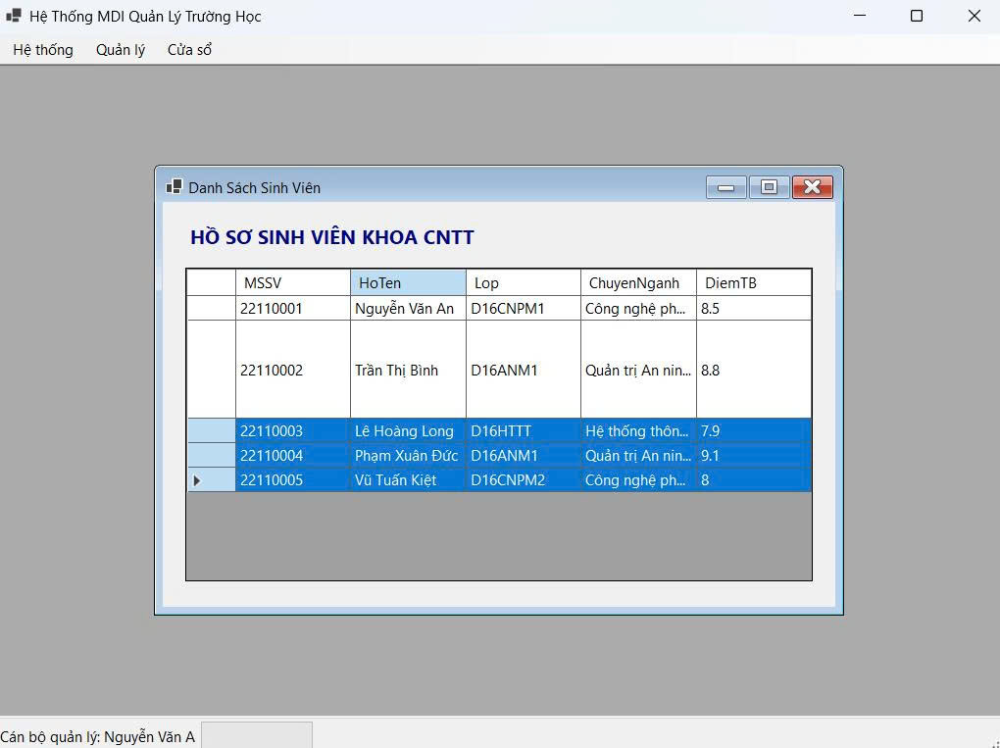 |

---

### BÀI 4: TỔNG HỢP BÁO CÁO KHO HÀNG (ASYNC / AWAIT)
| Đang tải (Không đơ Form) | Hủy tác vụ thành công | Kết quả tổng hợp báo cáo |
| :---: | :---: | :---: |
| 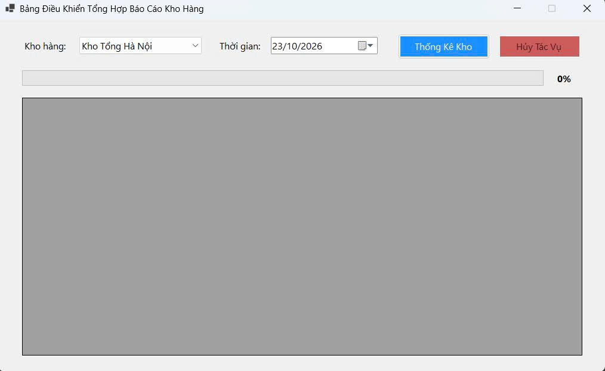 | .jpg) | 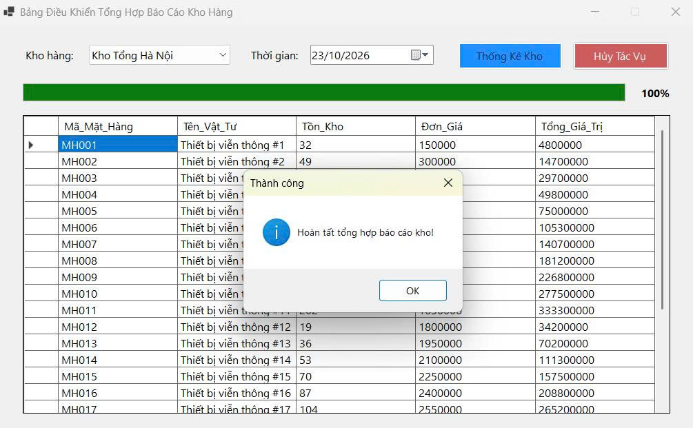 |

---

### BÀI 5: MÔ PHỎNG GIÁM SÁT IOT REAL-TIME (CROSS-THREAD SAFETY)

| Trạng thái Bình thường | Cảnh báo Vượt ngưỡng | Bảng Log & Đếm chu kỳ |
| :---: | :---: | :---: |
| 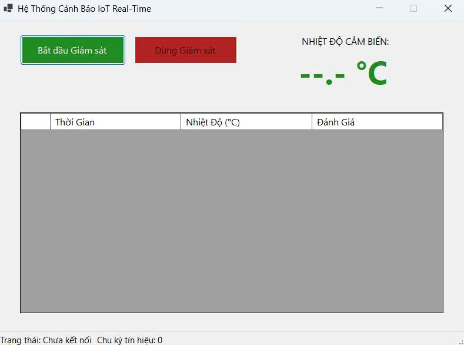 | 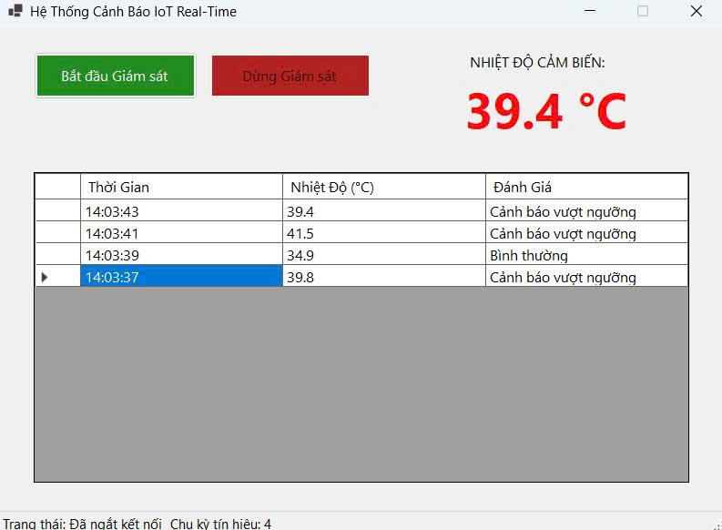 | 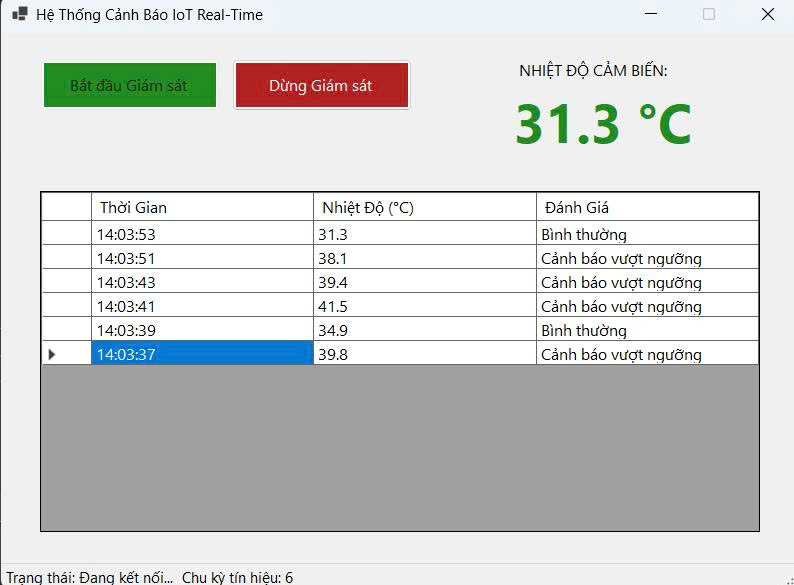 |

---

